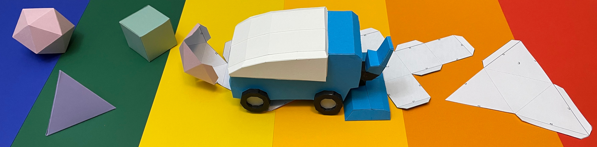
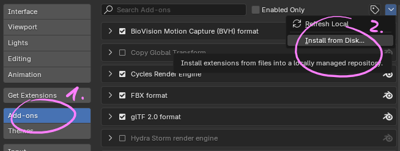
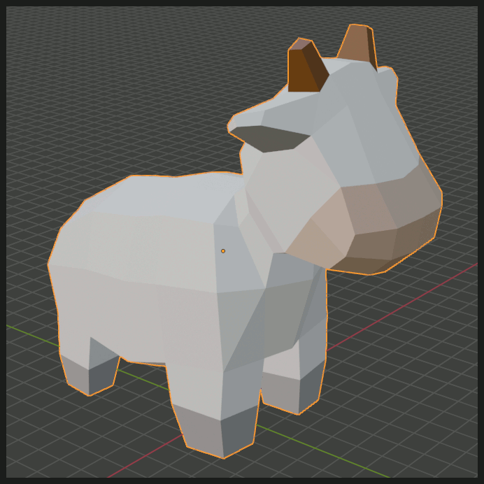
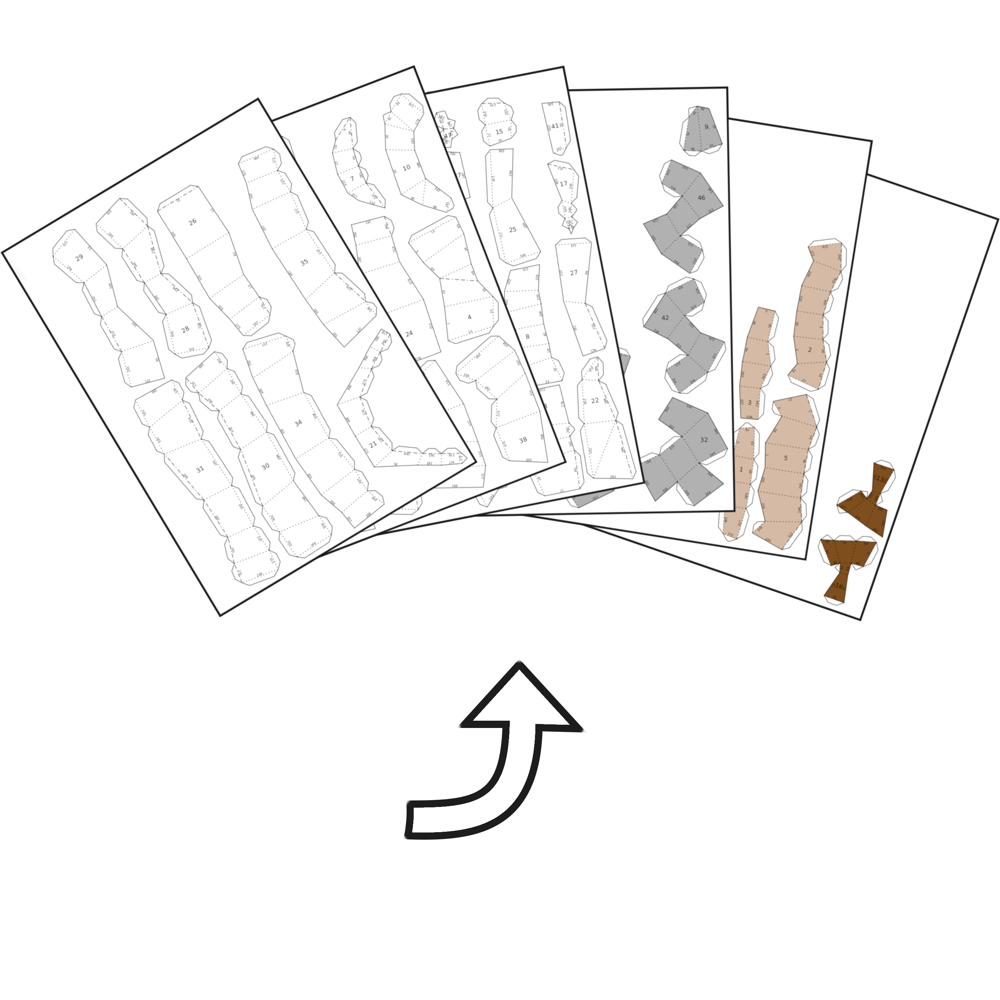
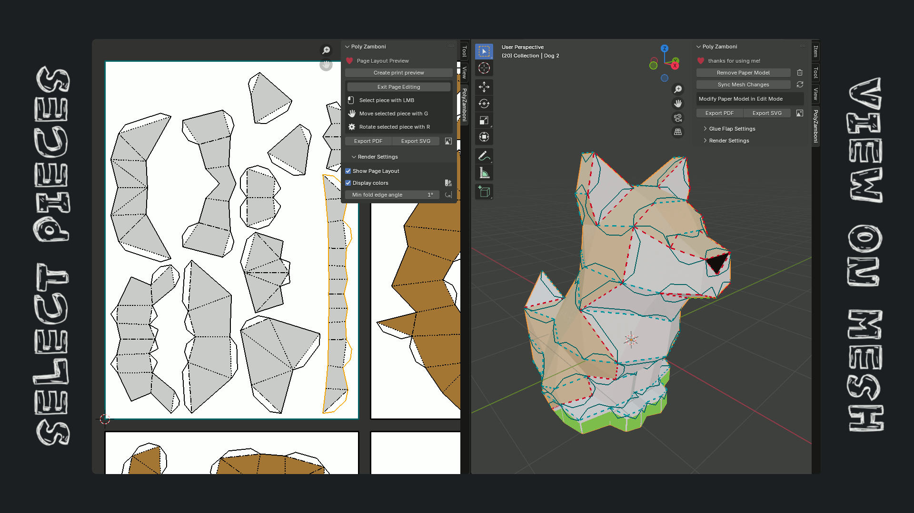

# PolyZamboni - Паперкрафт в Blender



Превратите свои low-poly модели в инструкции для паперкрафта с помощью этого аддона для Blender. Вам больше не нужен дополнительный софт или доверие к какому-то автоматическому алгоритму развёртки. PolyZamboni предоставляет все инструменты для создания высококачественных бумажных моделей!

<a href="https://www.github.com/AntonFlorey/PolyZamboni/releases"></a> <a href="https://www.github.com/AntonFlorey/PolyZamboni/releases"></a> <a href="https://github.com/AntonFlorey/PolyZamboni/blob/main/LICENSE"></a> <a href="https://github.com/AntonFlorey/PolyZamboni"></a>

<a href="https://buymeacoffee.com/antonflorei" target="_blank"></a>

## Установка аддона
Чтобы добавить PolyZamboni в Blender, клонируйте этот репозиторий и заархивируйте папку `PolyZamboni`, содержащую этот readme и файл `__init__.py`. Затем откройте Blender и перейдите в **Edit-><ins>P</ins>references**. В левой верхней части вкладки **Add-ons** нажмите на **<ins>I</ins>nstall from Disk** и выберите заархивированную папку `PolyZamboni`. Если все [необходимые пакеты Python](#требования) установлены, аддон должен быть готов к работе.



### PolyZamboni как расширение Blender
Если вы используете Blender версии 4.3, вы можете установить PolyZamboni как расширение Blender. Это позволит автоматически устанавливать все внешние пакеты Python. Несколько сборок этого аддона доступны [здесь](https://github.com/AntonFlorey/PolyZamboni/releases).

#### Отличные новости
Этот аддон был одобрен Blender! Просто перейдите в **Edit-><ins>P</ins>references->Get Extensions**, найдите "PolyZamboni" и установите аддон одним кликом.

## Использование
С включённым аддоном выберите любой объект-сетку и перейдите в панель PolyZamboni на боковой панели вьюпорта (переключается клавишей `'N'`), затем нажмите кнопку `Unfold this mesh`. Это запустит процесс развёртки выбранной сетки без начальных разрезов.
Не все сетки могут быть обработаны PolyZamboni. Следующие факторы не позволяют аддону работать с вашей сеткой:

1. Не-маніфолдні вершини або ребра
2. Грани, касаються більше ніж по одному ребру
3. Грани, які не можуть бути триангульовані алгоритмом PolyZamboni
4. Сильно некoplanарні грани

Вы получите предупреждение при возникновении одной из этих ошибок и возможность выбрать все грани, которые нужно исправить.

### Интерактивное редактирование бумажной модели

<p float="middle">
    
    
</p>

Чтобы превратить вашу 3D-модель в печатные детали, которые можно склеить в потрясающую бумажную модель, нужно определить, где сетку нужно разрезать и куда разместить клапаны для склейки. Вы можете редактировать разрезы и клапаны, войдя в `Edit Mode`. Здесь доступно множество мощных инструментов:

- `Separate Materials` добавляет разрезы между всеми гранями с разными материалами.
- `Auto Unfold` автоматически добавляет разрезы до тех пор, пока вся сетка не может быть развёрнута. Алгоритм пытается создать петли связанных граней. Вы можете выбрать, должны ли эти петли обвивать ось `X`, `Y` или `Z`. Также можно задать максимальное количество связанных граней.
- `Remove Auto Cuts` удаляет все автоматически добавленные разрезы, если результат предыдущей операции вас не устраивает.
- `Recompute Flaps` размещает клапаны на всех разрезанных рёбрах. Жадный алгоритм пытается избежать перекрытий печатных деталей. Рядом с кнопкой есть переключатель, который позволяет 결정ить, должны ли клапаны чередоваться вдоль границ областей.
- `Alt+C` открывает меню ручных разрезов. Здесь можно разрезать, очищать или склеивать все выбранные рёбра. Склеенные рёбра не могут быть разрезаны оператором `Auto Unfold`. Также можно выбрать несколько граней и пометить их как одну связную область через оператор `Define Region`.
- `Alt+X` открывает меню клапанов. Здесь можно добавлять, удалять и переворачивать клапаны на всех выбранных рёбрах.

### Интуитивная обратная связь
PolyZamboni отображает обратную связь поверх ваших моделей. Пунктирные линии на рёбрах сетки указывают одно из следующего:
- **Красные рёбра:** Ручные разрезы
- **Зелёные рёбра:** Ручные склейки (не могут быть автоматически разрезаны)
- **Синие рёбра:** Автоматические разрезы

Все связные области граней, разделённые разрезами, визуализируются цветными пятнами на гранях сетки. Эти области окрашены в зависимости от их качества:
- **Красные области:** Эти области не могут быть развёрнуты на лист бумаги. Если есть хотя бы одна такая область, бумажная модель не может быть создана.
- **Оранжевые области:** Хотя все грани могут быть развёрнуты, они будут перекрываться на плоскости. Это делает инструкции практически непригодными для использования.
- **Жёлтые области:** Почти идеальные области. Только клапаны для склейки перекрываются на финальной печати.
- **Зелёные области:** Эти области могут быть развёрнуты без каких-либо перекрытий. Если все области зелёные, всё готово!

Капаны также визуализируются на гранях в том положении, которое они будут занимать в паперкрафт-версии вашей модели. Если какой-либо клапан перекрывается с чем-то в инструкции, он будет окрашен в красный.

<p float="middle">
    
</p>

### Секции сборки и номера шагов
Для упрощения сборки бумажной модели можно разбить детали на секции сборки. Для этого перейдите в панель `Build Sections`, где вы увидите список всех секций сборки и следующие опции:
- Создать секцию сборки: Создаёт секцию из всех граней выделенной области.
- Удалить выбранную секцию сборки.
- Изменить острова выбранной секции сборки.
- Выбрать все грани сетки, принадлежащие выбранной секции сборки.
- Заблокировать и разблокировать секции сборки: Обычно при добавлении деталей в секцию они удаляются из предыдущих секций (деталь может быть только в одной секции). Блокировка секции предотвращает это.
- Переименовать секции сборки (непосредственно в списке).

Также можно сгенерировать номера шагов сборки для каждой детали, которые указывают порядок сборки. В режиме `Edit Mode` нажмите кнопку `Compute Build Order`. Теперь все детали внутри секции сборки размером n будут пронумерованы от 1 до n.

В финальных инструкциях каждая деталь будет напечатана с названием секции сборки и номером шага.

### Редактирование макета страниц
Перед экспортом инструкций для вашей модели PolyZamboni позволяет отредактировать финальный макет страниц. Для этого перейдите в `UV or Image-Editor` и откройте боковую панель. После нажатия на `Create print review` и настройки параметров макета на экране должна появиться предварительная страница со всеми деталями бумажной модели.

<p float="middle">
    
</p>

Затем вы можете отредактировать макет, нажав на `Edit page layout`. Здесь можно:
- Выбирать детали левым кликом.
- Перемещать выбранную деталь клавишей `g`. Поведение аналогично оператору перемещения Blender.
- Поворачивать выбранную деталь клавишей `r`. Поведение аналогично оператору вращения Blender.
- Изменить номер шага сборки выбранной детали клавишей `f`.

**Примечание:** Изменения разрезов бумажной модели удалят всю существующую информацию о макете страниц. Убедитесь, что вы удовлетворены своими разрезами и полученными деталями, прежде чем финализировать макет страниц.

### Экспорт инструкций
Когда вы будете удовлетворены своими правками, вы можете экспортировать инструкции бумажной модели. Перейдите в **File-><ins>E</ins>xport->Polyzamboni Export PDF/SVG** или просто нажмите соответствующие кнопки в боковой панели. PolyZamboni позволяет полностью настроить внешний вид инструкций. Вот список опций экспорта:
- Размер конечной модели. Можно задать целевую высоту модели или напрямую определить масштаб.
- Размер бумаги, поле страницы и расстояние между деталями сетки.
- Размеры и цвета шрифтов.
- Внешний вид рёбер (ширина, цвет, стиль линии и многое другое...)
- Текстурирование граней сетки (ничего, сплошной цвет или текстурное изображение)

**Совет:** Размер модели и поля измеряются в единицах текущей сцены Blender. Рекомендую установить единицы длины сцены на что-то вроде см, если только вы не планируете создавать огромные модели. Измените эту настройку в **Scene Properties->Units**.

## А теперь: Будьте креативны!
Мне не терпится увидеть, что вы сможете создать с этим аддоном. Делитесь своими крутыми паперкрафт-созданиями со мной и миром!


## Дополнительные функции
Я хочу объяснить ещё несколько интересных вещей, встроенных в этот аддон. Эти функции, возможно, потребуют доработки в будущем, так как они не так гибки и интуитивны, как остальные.

**Текстурирование граней:** Если ваша сетка имеет материалы, назначенные граням, вы можете перенести их в инструкции бумажной модели. Пока поддерживаются только сплошные цвета или одиночные текстурные изображения. PolyZamboni автоматически ищет ноды шейдеров `Principled BSDF` для получения базового цвета материала. Текстурное изображение берётся из ноды шейдера `Image Texture`. Несколько текстур не поддерживаются (в таком случае вы получите одну случайную текстуру). Feel free to adjust the code to make this feature more powerful. У меня мало опыта с текстурированием в blender, и это лучшее, что я мог придумать.


## Требования
Этот аддон использует некоторые внешние пакеты, не включённые в установку Python, поставляемую с Blender. Все необходимые пакеты (без зависимостей) перечислены в `requirements.txt`.

### Вот один из способов установки этих пакетов через pip:
Откройте предпочитаемую командную оболочку и перейдите в папку с бинарником Python вашей установки Blender.

```bash
cd 'some_path_prefix\Blender Foundation\Blender 4.3\4.3\python\bin'
```
Для справки, на моей Windows-машине точный путь к папке -
`'C:\Program Files\Blender Foundation\Blender 4.3\4.3\python\bin'`.

Затем установите недостающие пакеты через pip.

```bash
./python -m pip install -r "some_path_prefix\PolyZamboni\requirements.txt" --target="..\lib\site-packages" --upgrade
```
Убедитесь, что вы указали правильный путь к файлу требований, заменив `some_path_prefix` на расположение папки PolyZamboni на вашем компьютере.

### Несколько замечаний:
- Убедитесь, что у вас есть права на запись и изменение файлов в папке python. Самый простой способ - открыть оболочку от имени администратора.
- Это руководство по установке использует форматы путей Windows, но те же шаги должны работать и в Linux и macOS (пока не тестировано).

## Участие в переводе

PolyZamboni поддерживает интернационализацию (i18n) через встроенную систему переводов Blender. Переводы хранятся в `polyzamboni/translations/` — по одному файлу на каждый язык.

### Как добавить новый язык

1. Скопируйте существующий файл перевода (например, `en_US.py`) как шаблон
2. Переименуйте его на код вашего языка (например, `fr_FR.py`, `zh_CN.py`)
3. Переведите все значения в словаре — ключи (строки на английском) оставьте без изменений
4. Файл будет автоматически обнаружен и загружен при регистрации аддона

### Формат файла перевода

Каждый файл экспортирует словарь `translations`:

```python
translations = {
    ("Operator", "Unfold this mesh"): "Развернуть эту сетку",
    ("Panel", "Build Sections"): "Секции сборки",
    # ... больше переводов
}
```

Первый элемент каждого ключа — это контекст:
- **Operator** — лейблы операторов, описания, элементы перечисления, заголовки диалогов, строки интерфейса
- **Panel** — заголовки панелей
- **Property** — имена свойств, отображаемые в интерфейсе
- **Menu** — лейблы меню

### Поддерживаемые языки

| Язык | Код | Статус |
|------|-----|--------|
| Английский | en_US | Готово |
| Русский | ru_RU | Готово |
| Украинский | uk_UA | Готово |
| Испанский | es_ES | Готово |
| Французский | fr_FR | Готово |
| Немецкий | de_DE | Готово |
| Китайский (упрощённый) | zh_CN | Готово |
| Японский | ja_JP | Готово |
| Корейский | ko_KR | Готово |
| Португальский (Бразилия) | pt_BR | Готово |
| Итальянский | it_IT | Готово |

### Проверка переводов

1. Установите аддон в Blender
2. Перейдите в **Edit → Preferences → Interface → Translation**
3. Выберите нужный язык из списка
4. Все элементы интерфейса должны отображаться на выбранном языке
